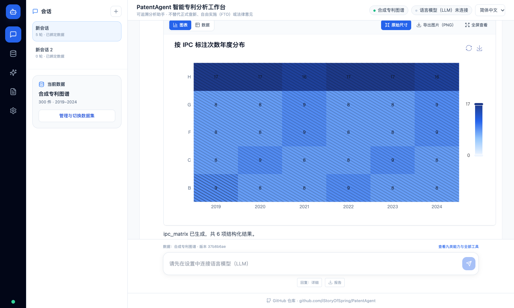
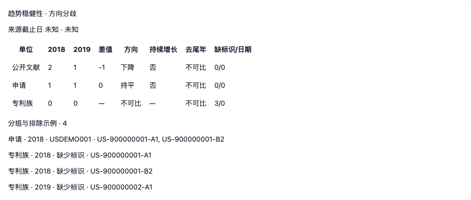
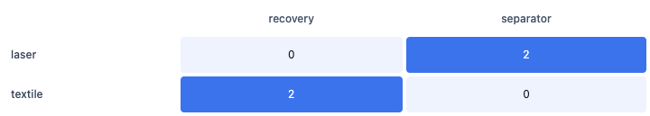
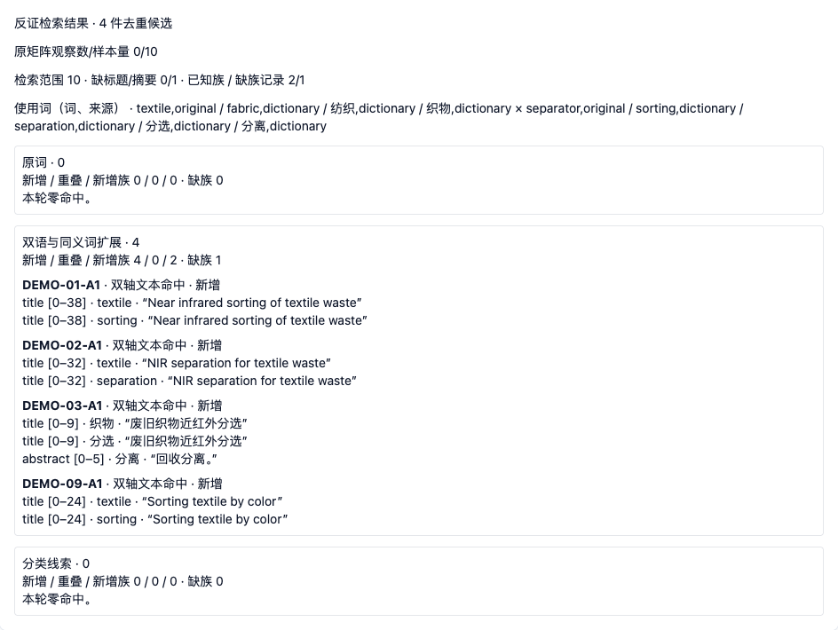

# PatentAgent

[简体中文](README.md)

**A local patent analysis workbench that lets you trace charts back to individual publications.** Import patent files, bind a dataset version to a session, and use 26 tools to study trends, competitors, and technology topics. Run analyses offline with Quick tools, or connect a language model to ask questions in natural language. The session records the tool parameters, supporting evidence, and results used in reports.

[Quick start](#quick-start) · [First analysis](#first-analysis) · [Review a zero in the matrix](#review-a-zero-in-the-matrix) · [Tool catalog](docs/tool-evidence-matrix.md) · [Models and MCP](#models-and-mcp)



*To reproduce the 2019–2024 heatmap, import the [300 synthetic Web of Science records](tests/fixtures/wos_golden/synthetic_wos.txt) and run **IPC distribution**. Each cell counts IPC assignments for that year. One publication can have several classifications. The screenshots use the Chinese interface. Select **English** in the app's language menu to follow the steps below.*

## Quick start

Install **Python 3.11–3.13, uv, Node.js 22.x (22.13 or later) or 20.x (20.19 or later), npm, Bash, and curl**. Initial setup needs access to package registries. If you downloaded a source archive, skip the clone step and run the second block from the extracted project root.

```bash
git clone https://github.com/iStoryOfSpring/PatentAgent.git
cd PatentAgent
```

```bash
uv sync --frozen --extra mcp --group dev
(cd frontend && npm ci)
bash start.sh
```

Once the launcher reports that PatentAgent is running, open the address printed in the terminal. The defaults are `http://127.0.0.1:5173` for the web interface and `http://127.0.0.1:8000` for the API. Keep the terminal open and press Ctrl+C to stop both services. The demo below runs with the bundled dataset and requires no model, EPO account, or API key.

## First analysis

To see how filing activity changed, choose the date that determines each record's year and the unit to count. This three-record example is small enough to check by hand.

1. **Import the sample.** Open **Datasets**, select [trend.jsonl](samples/offline/trend.jsonl), name the dataset, leave **Auto-detect (recommended)** selected, and click **Upload and import**. The dataset should contain three records.
2. **Bind the version.** Open **Analysis**, click **New session**, and go back to **Datasets**. Click **Bind session** on the dataset you just imported. Its card should say **Bound**.
3. **Run the analysis.** Open **Capabilities & Tools**. Under **Quick tools**, expand **Publication trend** and select **Filing date**, **Applications**, and **Yearly**. Click **Run**, then **Return to chat**.
4. **Inspect the evidence.** On the chart card, expand **Inspect publications counted in each bin**, select **2018**, and click **Load bin evidence**. The same application has two publication numbers, `US-900000001-A1` and `US-900000001-B2`.
5. **Check the trend.** Click **Audit annual trend robustness**. Grouped by filing year, application counts stay at **1 → 1** from 2018 to 2019, while publication counts fall from **2 → 1**. All three records lack a family ID, so the patent-family trend is marked **incomparable**.



To save the results, open **Reports** and click **Generate report for current session**. The walkthrough includes screenshots, a publication-number cross-reference, and upload recovery steps. [Illustrated walkthrough (Chinese)](docs/mentor-demo-guide.md)

## Review a zero in the matrix

A **0** in the technology-means/effect matrix is worth checking for alternate wording. Import and bind the [ten textile-sorting demo records](tests/fixtures/review_holdout/source/records.jsonl) in a new session. Run **Technology-means/effect matrix**, click **Return to chat**, and select the **0** at **textile × separator**. PatentAgent searches titles and abstracts within the selected scope and distinguishes original-term matches, bilingual synonym matches, and classification leads for manual review.



The original terms returned zero matches. The expanded search returned **four distinct candidate publications**. For example, `DEMO-01-A1` is titled *Near infrared sorting of textile waste*. The title matches *textile* on the technology axis and *sorting* as an expansion of the effect term. Check each record's publication number, matched field, and excerpt. Use classification and single-axis matches as reading leads. A claim about novelty or a market opportunity requires evidence beyond the count in this matrix. [Reproduce the matrix review (Chinese)](docs/mentor-demo-guide.md#复核矩阵里的零值)

<details>
<summary>See the four candidates and their matching excerpts</summary>



</details>

## What you can analyze

| Question | Workbench tools |
| --- | --- |
| Did filing activity change, or were there multiple publications for the same application? | Publication trends, cumulative and year-over-year counts, robustness checks across three counting units, and year-level evidence. |
| Who is filing, and who works together? | Applicant portfolios, concentration, collaboration networks, and changes in competitors' IPC profiles. |
| How have technology topics changed over time? | IPC distributions, topic clustering, yearly keywords, growing terms, and topic timelines. |
| Which documents should I read for a sparsely populated matrix cell? | Technology-means/effect matrices, two-axis counterevidence search, lexical search, search-strategy audits, and publication details. |
| How can I review families, citations, legal status, and claims? | Family and geographic summaries, internal and external citations, legal status as of the source date, and claim-element review. |
| How can I save or reuse the analysis? | Bind a version to the session, generate an HTML report, inspect structured results, or use the same tool registry via MCP. |

Tool availability depends on field coverage in the bound dataset. **Capabilities & Tools** shows the available analyses. Developers can query `GET /api/tools` for the runtime catalog. [Methods, data requirements, and interpretation limits](docs/tool-evidence-matrix.md)

In search results, patent details, and chart evidence, supported publication numbers can open in Google Patents. When you click the link, the browser sends the publication number to Google. Results depend on Google Patents' coverage.

## Supported data sources

| Source | How to use it | Scope |
| --- | --- | --- |
| Web of Science / Derwent | Upload tagged TXT exports. | Analyze supplied fields such as bibliographic metadata, classifications, and abstracts. |
| Google Patents Public Data | Upload JSONL with one record per line. | Import exported bibliographic data, text, classifications, and available family IDs. |
| USPTO | Upload full-text grant XML or Patent File Wrapper JSON. | The two formats provide different levels of detail for grants, applications, and events. |
| PatentAgent canonical records | Upload canonical JSONL. | Reuse normalized records such as those from a published acquisition. |
| EPO Open Patent Services (OPS) | Configure credentials, then create and confirm a bibliographic acquisition in **Datasets**. | Up to 1,000 records per acquisition. Publication requires a complete result set. Live account validation is pending. |
| CNIPA | Obtain an official export and check it against the supported file formats. | File-based import. |

If automatic detection fails, choose the source format manually. The source matrix documents file signatures, manifest checks, field coverage, and the status of online acquisition. [Data source matrix](docs/data-source-capabilities.md)

## Models and MCP

To let the agent choose tools based on a question, add a provider in **Settings**, enter the model and endpoint, then select **Save and connect**. With the trend sample bound, ask *Count applications by filing year* and check the actual tool parameters. A remote provider processes the question and the tool results used to answer it. Credentials stay in backend process memory and need to be entered again after a restart.

MCP clients can use the same tools. From the project root, start the stdio server with the bundled sample dataset.

```bash
MCP_INPUT_DIR=./samples/offline uv run --frozen --extra mcp python mcp_server.py
```

The server waits for a client to communicate over standard input and output. The integration guide covers desktop client configuration, HTTP limitations, dataset directories, and starting the frontend and API separately. [Configuration and integration guide](docs/integrations.md)

## Troubleshooting

| What you see | What to do |
| --- | --- |
| The chat input asks you to connect a model. | Use **Quick tools** in **Capabilities & Tools** for the offline demo. Connect a model in **Settings** to ask questions in natural language. |
| Two publication numbers appear, but the chart counts one item. | Check the chart's counting unit. An A1 publication and a B2 grant can share a single application ID. |
| Previous results become stale after you switch datasets. | Verify the version bound to the session, then rerun the source chart on that version before starting a review. |
| Port 8000 or 5173 is in use. | Run `PATENTAGENT_BACKEND_PORT=8100 PATENTAGENT_FRONTEND_PORT=5174 bash start.sh` and open the address printed in the terminal. |
| You are starting PatentAgent on a server or without a desktop. | Run `PATENTAGENT_OPEN_BROWSER=0 bash start.sh` to disable automatic browser launch. |

## Development and documentation

The web interface uses React, TypeScript, and ECharts. FastAPI serves REST endpoints and server-sent events. SQLite stores sessions and execution evidence. The web and MCP interfaces share the Python tool registry. After installing the dependencies, run these checks from the project root.

```bash
uv run --frozen --extra mcp python -m pytest -q
(cd frontend && npm test -- --run && npm run build)
python3 scripts/check_doc_links.py
```

- [Illustrated walkthrough](docs/mentor-demo-guide.md) · [Configuration and integration](docs/integrations.md)
- [Trend audits and counterevidence search design, API, and evaluation](docs/development/trend-and-gap-review.md)
- [Maintenance, CI, and release checks](docs/development/reliability-and-release.md) · [Changelog](CHANGELOG.md)
- [Historical validation for v3.1](docs/validation-report-v3.1.md) · [Algorithm audit](docs/algorithm-audit.md) · [Project and paper audit](docs/project-audit.md)

## License and provenance

PatentAgent is developed by Wu Jinhong and Chen Siyu and released under the [GNU Affero General Public License v3](LICENSE). Contact the project at `2507380208@wtu.edu.cn`.

PatentAgent began with PatentSmelter and retains the original MIT notice for reused parser code. IPAgent-OS inspired the independently implemented publication lookup. [PatentSmelter](https://github.com/iStoryOfSpring/PatentSmelter) · [PatentSmelter MIT notice](https://github.com/iStoryOfSpring/PatentAgent/blob/main/LICENSE-PatentSmelter.md) · [IPAgent-OS](https://github.com/iStoryOfSpring/IPAgent-OS)
