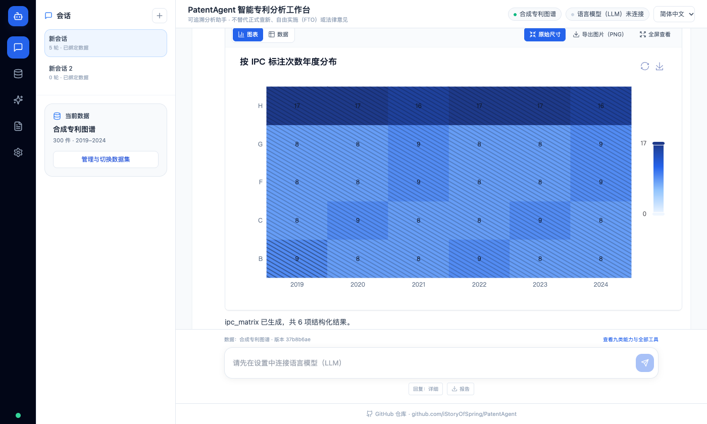
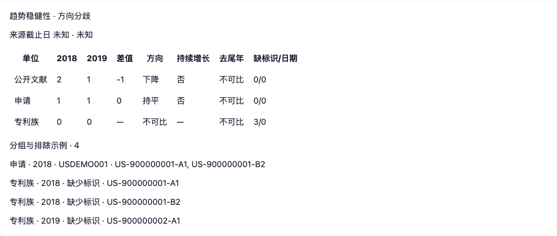
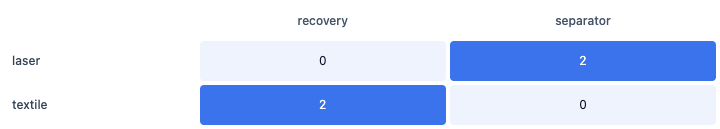
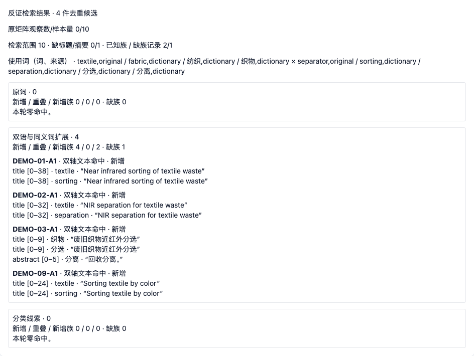

# PatentAgent

[English](README.en.md)

**一个可以从图表查回公开号的本地专利分析工作台。** 导入专利文件，选定数据版本，用 26 个分析工具研究趋势、竞争格局和技术主题。快捷分析可以离线运行；连接语言模型后，也可以用中文提问，在同一会话里查看工具参数、原始证据和报告。

[快速开始](#快速开始) · [第一次分析](#第一次分析) · [从矩阵找回文献](#从矩阵找回文献) · [工具目录](docs/tool-evidence-matrix.md) · [模型与 MCP](docs/integrations.md)



*图中是当前 Web 工作台。导入仓库的 [300 条合成 WoS 文献](tests/fixtures/wos_golden/synthetic_wos.txt)，运行「IPC 分类分布」，就能得到这张 2019–2024 年热力图。每格是该年度的分类标注次数，一篇文献可以有多个分类。*

## 快速开始

准备 **Python 3.11–3.13、uv、Node.js 22.x（至少 22.13）或 20.x（至少 20.19）、npm、Bash 和 curl**。首次安装需要访问软件包源。以下命令适用于 Bash 环境，已下载源码包的用户从解压后的项目根目录执行第二段即可。

```bash
git clone https://github.com/iStoryOfSpring/PatentAgent.git
cd PatentAgent
```

```bash
uv sync --frozen --extra mcp --group dev
(cd frontend && npm ci)
bash start.sh
```

看到「PatentAgent 已启动」后打开终端显示的地址，默认前端为 `http://127.0.0.1:5173`，后端为 `http://127.0.0.1:8000`。保持终端开启，按 Ctrl+C 结束本次启动的服务。完成下面的演示无需配置模型、EPO 账号或 API Key。

## 第一次分析

要回答“申请量有没有变化”，先决定**按哪种日期归年、按什么单位计数**。用这份只有三条文献的样例，可以手工核对整个过程。

1. **上传。** 打开「数据集」，选择 [trend.jsonl](samples/offline/trend.jsonl)，填写数据集名称，保留自动识别，点「上传并导入」。导入完成后应有 3 条记录。
2. **绑定版本。** 在「智能分析」中新建会话，回到「数据集」，在刚上传的卡片上点「绑定会话」。已显示「已绑定」即可继续。
3. **生成图表。** 打开「能力与工具」，在快捷工具栏展开「公开趋势」，依次选择 **申请日期 / 申请 / 按年**。点「执行」，再点「回到聊天页面」。
4. **核对证据。** 在图表卡中展开「按统计分组查看原始文献证据」，选择 2018，点「查看此分组证据」。你会看到同一个申请下有 `US-900000001-A1` 和 `US-900000001-B2` 两个公开号。
5. **复核趋势。** 点「核查年度趋势稳健性」。同样按申请日期归年，2018→2019 的申请数是 **1→1**，公开文献数是 **2→1**。三个记录都缺族标识，所以专利族方向显示「不可比」。



需要保存结果时，在「报告」页点「生成当前会话报告」。逐步截图、公开号对照表和重传办法见[图文操作指南](docs/mentor-demo-guide.md)。

## 从矩阵找回文献

技术手段—功效矩阵里出现 **0**，值得先查一遍同义表达。在[十条纺织分选演示记录](tests/fixtures/review_holdout/source/records.jsonl)中，运行矩阵后点击 **textile × separator (0)**。工具在当前选定范围重新检索标题和摘要，区分原词命中、双语同义词命中及需要人工阅读的分类线索。



这次原词轮为 0，扩展后有 **4 篇去重候选**。例如 `DEMO-01-A1` 的标题写的是 *Near infrared sorting of textile waste*，技术词是 *textile*，第二个轴命中 *sorting*。结果中可逐篇核对公开号、命中字段和原文片段。分类与单侧词命中只提供阅读线索；零命中也无法证明新颖性或市场空白。[查看反证结果截图和复现步骤](docs/mentor-demo-guide.md#复核矩阵里的零值)

<details>
<summary>查看这次检索的 4 篇候选及原文片段</summary>



</details>

## 可以分析什么

| 要回答的问题 | 工作台中可用的方法 |
|---|---|
| 年度变化来自申请增加，还是同一申请的多次公开？ | 公开趋势、累计与同比、三种单位的稳健性复核、按年份下钻证据 |
| 哪些主体在布局，合作格局如何？ | 申请人组合、集中度、合作网络、竞争者 IPC 构成变化 |
| 技术方向如何演变？ | IPC 分布、主题聚类、逐年关键词、增长词、技术主题时间线 |
| 一个看似稀疏的组合，还有哪些文献值得读？ | 技术功效矩阵、双轴反证检索、词法检索、检索策略审计、记录详情 |
| 如何审阅同族、引证和法律信息？ | 同族与地域分布、内部与外部引证、带来源时点的法律状态、权利要求要素复核 |
| 怎么保存或复用这次工作？ | 绑定会话版本、生成 HTML 报告、查看结构化结果，或通过 MCP 调用同一工具注册表 |

可用程度随数据字段覆盖而变。在「能力与工具」查看当前数据适用的工具；开发者可从 `GET /api/tools` 读取运行时清单。每项工具的算法、数据门槛和解释限制集中在[算法证据矩阵](docs/tool-evidence-matrix.md)。

## 可以导入哪些数据

| 来源 | 使用方式 | 范围 |
|---|---|---|
| Web of Science / Derwent | 上传带字段标记的 TXT | 可从题录、分类、摘要等已提供字段分析 |
| Google Patents Public Data | 上传 JSONL，每行一条记录 | 导入导出的题录、文本、分类和已有同族标识 |
| USPTO | 上传授权全文 XML 或 Patent File Wrapper JSON | 两种格式分别提供不同粒度的授权文献、申请和事件字段 |
| PatentAgent 标准记录 | 上传 canonical JSONL | 重放已规范化的文献，例如已发布的采集版本 |
| EPO OPS | 配置凭据后在「数据集」创建并确认题录采集任务 | 单次最多 1,000 条，集合不完整时不会发布；真实账号验证待完成 |
| CNIPA | 取得官方导出，先核对文件结构与受支持的格式 | 当前走文件流程，尚无在线 REST 适配器 |

自己的文件识别失败时，可以手动指定来源格式。支持的内容签名、清单校验、字段覆盖和在线渠道状态见[数据源能力矩阵](docs/data-source-capabilities.md)。

## 模型与 MCP

快捷工具适合已知分析问题。若要让 Agent 选择工具，在「设置」新增供应商配置，填写模型和端点，选择「保存并连接」。例如，绑定三条演示记录后提问「按申请日统计申请数，按年分组」，然后核对实际工具参数。使用远程供应商时，问题和用于回答的工具结果会经该服务处理；凭据保存在后端进程内存，重启后重新输入。

外部客户端也可通过 MCP 使用这些工具。stdio 模式可从项目根目录直接对仓库样例启动：

```bash
MCP_INPUT_DIR=./samples/offline uv run --frozen --extra mcp python mcp_server.py
```

stdio 进程等待客户端通过标准输入输出通信。桌面客户端配置、HTTP 入口的已知限制、数据目录和分开启动前后端的命令见[配置与集成指南](docs/integrations.md)。

## 常见问题

| 现象 | 怎么处理 |
|---|---|
| 对话输入框提示需要连接模型 | 离线演示从「能力与工具」的快捷工具启动。需要自然语言对话时再到「设置」连接模型。 |
| 图里有两份公开文献，统计却只有一件 | 先看图标题中的单位。申请数按申请标识归组，同一次申请的 A1 和 B2 可以属于同一组。 |
| 更换数据集后旧结果提示过期 | 核对会话当前绑定版本，在目标版本上重新运行来源图表，再发起复核。 |
| 本机 8000 或 5173 已被占用 | 可运行 `PATENTAGENT_BACKEND_PORT=8100 PATENTAGENT_FRONTEND_PORT=5174 bash start.sh`，打开终端打印的地址。 |
| 在服务器或无桌面环境启动 | 用 `PATENTAGENT_OPEN_BROWSER=0 bash start.sh` 关闭自动打开浏览器。 |

## 开发与文档

Web 端使用 React、TypeScript 和 ECharts，FastAPI 提供 REST 与 SSE；会话及执行证据保存在 SQLite。MCP 和 Web 复用 Python 工具注册表。开发环境完成快速开始中的依赖安装后，可在项目根目录运行：

```bash
uv run --frozen --extra mcp python -m pytest -q
(cd frontend && npm test -- --run && npm run build)
python3 scripts/check_doc_links.py
```

- [图文操作指南](docs/mentor-demo-guide.md) · [配置与集成指南](docs/integrations.md)
- [趋势核查与反证检索的设计、接口及评测](docs/development/trend-and-gap-review.md)
- [维护、CI 与发布验收](docs/development/reliability-and-release.md) · [更新日志](CHANGELOG.md)
- [历史版本验证记录](docs/validation-report-v3.1.md) · [内部算法审计](docs/algorithm-audit.md) · [项目与论文审计](docs/project-audit.md)

PatentAgent 源自 [PatentSmelter](https://github.com/iStoryOfSpring/PatentSmelter)。沿用的解析代码保留了 [PatentSmelter 的 MIT 许可声明](LICENSE-PatentSmelter.md)。专利检索、详情和图表证据中的公开号外查入口受 [IPAgent-OS](https://github.com/iStoryOfSpring/IPAgent-OS) 启发，由 PatentAgent 独立实现。点击 Google Patents 链接时，浏览器会把该条公开号发送给 Google。查询结果取决于 Google Patents 的收录范围。

作者为 Wu Jinhong、Chen Siyu。项目采用 [GNU AGPL v3](LICENSE)，联系邮箱为 2507380208@wtu.edu.cn。
