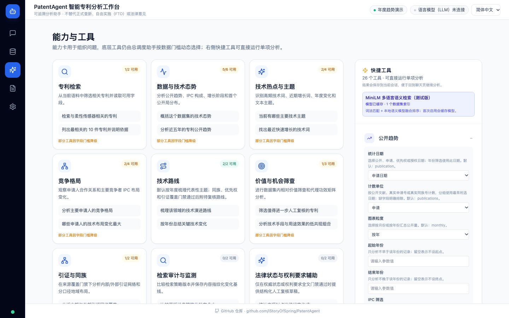
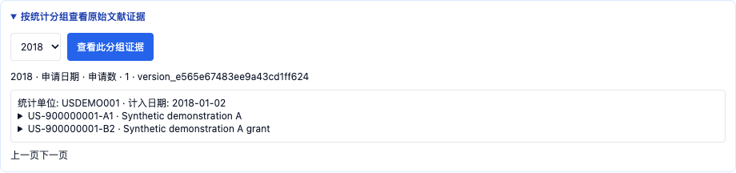
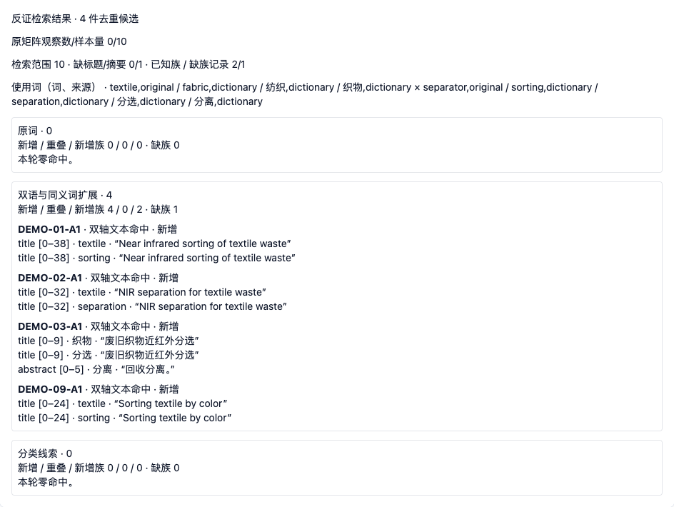

# 离线图文操作指南

从[快速开始](../README.md#快速开始)安装并启动 PatentAgent。这里的图片取自提交 `0bcc172` 的本机 Web 界面，使用仓库里的合成文件和空白会话数据库。读者可按下表选择演示。

| 想验证什么 | 上传哪个文件 | 可以核对什么 |
|---|---|---|
| 申请和公开文献怎样归组 | [年度趋势样例，3 条](../samples/offline/trend.jsonl) | 同一申请有 A1 和 B2 两个公开号 |
| 矩阵空格能否找回文本线索 | [纺织分选样例，10 条](../tests/fixtures/review_holdout/source/records.jsonl) | 原词 0 篇，双语扩展后 4 篇待核 |
| 复现首页热力图 | [WoS 合成样例，300 条](../tests/fixtures/wos_golden/synthetic_wos.txt) | 2019–2024 年按 IPC 标注次数分布 |

## 从申请数查回公开号

1. 在「数据集」选择年度趋势样例，名称填「年度趋势演示」，保留自动识别，点「上传并导入」。看到 3 条文献后可在版本历史查看版本 ID。
2. 在「智能分析」点「新会话」，回到「数据集」，在样例卡片点「绑定会话」。如果已经显示「已绑定」，直接继续。
3. 打开「能力与工具」。在右侧快捷工具栏展开「公开趋势」，选申请日期（`filing`）、申请（`applications`）、按年（`yearly`），点「执行」，再点「回到聊天页面」。



4. 图标题应为「申请日期 · 申请数」。展开「按统计分组查看原始文献证据」，选择年份，点「查看此分组证据」。查看明细的版本 ID 是否与绑定版本相同。

| 申请年 | 申请数 | 组内公开号 |
|---|---:|---|
| 2018 | 1 | US-900000001-A1、US-900000001-B2 |
| 2019 | 1 | US-900000002-A1 |



5. 点击年度图的「核查年度趋势稳健性」。同一申请日期窗口内，公开文献数为 2→1，申请数为 1→1。三条文献均缺族标识，表中已知族数为 0，方向显示「不可比」。这份样例只有两年，去掉尾年后也无法比较方向。
6. 到「报告」页选择「生成当前会话报告」，再打开报告。会话中的图、统计摘要及证据可用来说明你采用的口径。

## 复核矩阵里的零值

1. 上传纺织分选样例，命名为「纺织分选演示」。若要保留上一组演示的有效证据，先新建一个会话，再绑定新版本；在原会话切换版本会把旧工具证据标为过期。
2. 在「能力与工具」运行「技术手段—功效矩阵」，点「回到聊天页面」，在 `textile` 行点 `separator` 列的 **0**。也可以从「矩阵候选组合」选择该组合，在「扩展词与分类线索」里填写两侧同义词、IPC 或 CPC 前缀后再检索。
3. 直接点击该零值格时，原矩阵观察数/样本量为 **0/10**，扩展轮显示 **4** 篇去重候选。核对 `DEMO-01-A1` 的标题中 *textile* 和 *sorting* 的命中，以及 `DEMO-03-A1` 的中文片段。每篇候选均需按实际研究问题阅读。



另一个可复算的例子使用相同文件，检索问题换为 **near infrared × sorting** 并加入 IPC 前缀 **B07C**。在仓库根目录执行：

```bash
uv run --frozen --extra mcp python -m scripts.evaluate_gap_review
```

该问题预先标记了 5 篇相关文献。原词找到 1 篇（需看 2 篇），加入双语词找到 4 篇（累计需看 5 篇），再加入分类线索找到 5 篇（累计需看 8 篇）。分类这一轮多找回一篇相关文献，同时多引入两篇干扰项。数字仅描述这组有标签的合成数据。

## 复现首页热力图

新建会话，上传并绑定上表的 300 条 WoS 合成记录。在「能力与工具」的快捷工具中执行「IPC 分类分布」，保留默认计数方式，返回聊天并点「适应窗格」。纵轴是 IPC 部，横轴是年份。例如 H 部在 2019 年和 2021 年分别有 17 次和 16 次标注。[查看首页实拍图](images/ipc-workspace.png)

## 导入中断与模型对话

- 上传期间服务重启时，先看原任务 ID 的状态。版本已登记且可核实会恢复为完成。若提示中断，重新选择文件上传；相同内容可复用已登记版本。恢复冲突时保留现场和任务 ID。[恢复规则](development/reliability-and-release.md)
- 连接模型后，在已绑定趋势样例的会话里提问「按申请日统计申请数，按年分组」。把模型选择的参数与上面的手动步骤对照。启动模型对话和运行离线快捷工具分别使用各自的入口。[模型配置](integrations.md)
